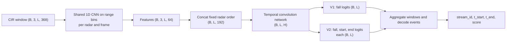

# Đề xuất baseline thử nghiệm CNN–TCN cho ABC2027 UWB

> **Trạng thái:** tài liệu thiết kế, chưa thực thi và chưa kiểm chứng. CNN–TCN V1/V2 là đề xuất của nhóm, không phải baseline chính thức. Chỉ điền kết quả sau thí nghiệm hợp lệ.

## 1. Mục tiêu và phạm vi

Bài toán là phát hiện và định vị sự kiện ngã trong stream UWB liên tục, chưa chia đoạn. Thử nghiệm đề xuất giữ dự đoán theo frame để định vị thời gian; phép so sánh chính là V1 (fall head) với V2 (fall head cộng hai boundary head).

Tài liệu phân biệt rõ baseline ban tổ chức (energy, logistic regression), mốc số liệu công bố trong README, và mô hình đề xuất của nhóm. Điểm README dưới đây chỉ để tham chiếu; không phải kết quả của V1/V2 và không dự báo điểm test.

Chỉ dùng stream đã phát hành ở <DATA_ROOT>/streams/train và <DATA_ROOT>/streams/val. Quy định cuộc thi cấm dùng UWB nguồn LIARA (kể cả bản sao bên ngoài); không dùng thư mục segments/ hay test bị giữ kín. Không sử dụng ground-truth boundary lúc suy luận.

## 2. Hợp đồng dữ liệu theo README phát hành

- HDF5 chứa cir float32 dạng (3,T,368), t tính bằng giây và radar_serials. Ba radar được đồng bộ ở 50 Hz.
- Giữ thứ tự cảm biến cố định theo radar_serials cho train, validation và inference.
- streams_events.csv chứa nhãn fall. Sự kiện bắt đầu ở onset chuyển động ngã và kết thúc khi người ổn định trên sàn; thời gian nằm yên sau đó không thuộc fall.
- Timestamp nhãn bất định khoảng ±0,5–1 giây. Evaluator báo cáo tolerance này riêng; nó không đổi phép match theo tIoU.
- Submission CSV có stream_id,t_start,t_end,score; t_alarm tùy chọn. Hai mốc phải ở trong stream và t_start < t_end.
- Dùng evaluator chính thức trên validation với --ignore-flagged để xử lý quality=low và needs_review theo quy tắc cuộc thi.

## 3. Baseline chính thức và tham chiếu công bố

Số dưới đây chép theo README của gói phát hành, làm tròn như README. Ngưỡng baseline đã được chỉnh trên validation nên không phải ước lượng hiệu năng test.

| Phương pháp | Nguồn | Mean F1 @ 0.1/0.3/0.5 | F1 @ 0.1 | F1 @ 0.3 | F1 @ 0.5 | F1 @ 0.7 |
|---|---|---:|---:|---:|---:|---:|
| Energy | Baseline chính thức; tham chiếu README | 0.315 | 0.358 | 0.338 | 0.249 | 0.060 |
| Logistic regression | Baseline học được chính thức; tham chiếu README | 0.258 | 0.593 | 0.167 | 0.014 | 0.000 |
| CNN–TCN V1 | Đề xuất nhóm; **chưa chạy** | — | — | — | — | — |
| CNN–TCN V2 | Đề xuất nhóm; **chưa chạy** | — | — | — | — | — |

## 4. Kiến trúc đề xuất

Cửa sổ khởi đầu L=400 frame (8 giây ở 50 Hz). Dự đoán tại toàn bộ frame của cửa sổ, không gom thành một nhãn duy nhất. CNN chạy trên trục range-bin, TCN chạy trên trục thời gian.



### V1: phân loại ngã theo frame

1. Dùng cùng một CNN 1D trên 368 range-bin cho từng radar-frame để lấy vector 64 chiều.
2. Nối ba vector theo thứ tự radar cố định thành (B,L,192).
3. TCN tạo fall logit mỗi frame, dạng (B,L).
4. Dùng sigmoid/BCE và điều chỉnh mất cân bằng lớp chỉ từ train; không tính loss trên frame ignore hoặc padding.

### V2: thêm nhánh biên bắt đầu/kết thúc

Giữ backbone và fall head của V1, thêm start_logit và end_logit theo frame. Target biên nên mềm thay vì đánh dương một frame duy nhất do timestamp không chắc chắn. Chốt bề rộng target và trọng số boundary loss trước khi chạy; nếu khảo sát nhiều giá trị thì dùng lưới nhỏ định trước trên validation. So sánh V1/V2 với cùng split, seed, tiền xử lý và ngân sách tuning. Đây là cảm hứng từ phân loại frame kết hợp dự đoán biên của ASRF, không phải tái hiện chính xác ASRF.

## 5. Cửa sổ, nhãn và tiền xử lý

| Thành phần | Cấu hình khởi đầu | Trạng thái |
|---|---|---|
| Tần số | 50 Hz | Theo README |
| Chiều dài cửa sổ | 400 frame (8 giây) | Đề xuất, chưa tối ưu |
| Bước cửa sổ | 50 frame (1 giây) | Đề xuất, chưa tối ưu |
| Đầu vào | (B,3,400,368) | Theo trục radar, thời gian, range-bin |
| CNN | 64 đặc trưng/radar-frame | Đầu ra nối thành 192 chiều |
| TCN | (B,L,H) | H cần chốt trong config; chưa tuyên bố tham số/receptive field |

- Fit thống kê chuẩn hóa chỉ trên frame train hợp lệ; dùng nguyên trạng cho validation/test.
- Không mặc định dùng band-pass, cắt 50 frame đầu, hoặc trừ nền EMA: đó không phải yêu cầu README. Nếu thử trừ nền, tách thành ablation và giữ ánh xạ timestamp về stream gốc.
- Dùng t để ánh xạ frame sang thời điểm sự kiện. Ghi rõ quy ước gán frame trong khoảng sự kiện và dùng nhất quán.
- Gán fall target theo khoảng đã chú giải; không dùng ground-truth boundary trong inference.
- Padding ngoài stream có valid-mask bằng 0 và không tham gia loss. Vùng ignore không được xem là negative. Cửa sổ chồng lấp giữ nhãn theo thời gian stream tuyệt đối, kể cả sự kiện cắt ranh giới cửa sổ.
- Không tạo nhãn phụ ADL/ngồi/nằm nếu dữ liệu không cung cấp.

## 6. Kế hoạch huấn luyện trong tương lai

Chỉ thực hiện nếu nhóm quyết định cấp quyền chạy trên GPU thuê; tài liệu này không chạy hoặc đặt lịch việc tính toán nào.

- Đọc HDF5 theo lát cửa sổ từ <DATA_ROOT>, không nạp toàn bộ stream; chỉ dùng streams/train để cập nhật trọng số.
- Giữ nguyên split; không dùng test chọn kiến trúc, checkpoint, ngưỡng hay decoder.
- Chốt seed, cấu hình và lưới tham số nhỏ trước khi chạy; lưu checkpoint tốt nhất theo tiêu chí validation chính và metric từng stream.
- V1: BCE có điều chỉnh mất cân bằng lớp. Theo dõi precision/recall theo frame nhưng chọn mô hình bằng metric sự kiện chính thức.
- V2: fall loss cộng hai boundary loss. Dùng cùng điều kiện V1 để cô lập tác động của boundary head.
- Batch size và mixed precision là tùy chọn cho phiên chạy tương lai, phải xác nhận trên máy thuê. Chưa có ước lượng VRAM, thời gian hoặc chi phí.
- Giới hạn số lựa chọn trên validation, ghi lại mọi lần thử để giảm overfit do tuning.

## 7. Inference và giải mã

Thiết kế inference là offline trên stream với cửa sổ chồng lấp. Cửa sổ có ngữ cảnh trước/sau nên chưa tuyên bố hỗ trợ cảnh báo online hoặc latency thời gian thực.

1. Chạy mỗi cửa sổ, ánh xạ frame logits về thời gian stream và trung bình các dự đoán trùng nhau theo số lượt được phủ; ở mép stream chỉ dùng frame hợp lệ.
2. V1: threshold fall probability thành đoạn ứng viên; gộp nếu khoảng trống nhỏ hơn merge_gap và bỏ đoạn ngắn hơn min_duration. Chọn các tham số bằng lưới nhỏ trên validation. merge_gap là nối đoạn theo thời gian, khác NMS.
3. V2: lấy đoạn V1 làm ứng viên rồi hiệu chỉnh hai mép bằng start/end peak gần đó. Nếu biên không đủ tin cậy thì fallback về mép V1 và ghi số lần fallback. Chốt dải tìm kiếm trước khi đánh giá.
4. Đề xuất score là fall probability trung bình trong đoạn sau decode; dùng nhất quán khi xếp hạng. Ban đầu không cần HMM/NMS; nếu thêm thì đánh giá như ablation riêng.
5. Không tạo t_alarm giả. Chỉ xuất cột này khi đã xác định thời điểm alarm thật từ một pipeline causal. Báo cáo thời gian tính toán mỗi stream riêng, không nhầm với detection latency của evaluator.

## 8. Đánh giá và bảng dự kiến

Dùng evaluator chính thức trên validation với --ignore-flagged. Match sự kiện theo tIoU; vùng ignore không tính TP/FN và prediction chạm vùng ignore được xử lý theo đúng thứ tự/quy tắc evaluator.

- Metric xếp hạng chính: mean event F1 tại tIoU 0.1, 0.3, 0.5.
- Báo cáo F1 tại 0.7, mean tIoU, lỗi start/end, false alarms/giờ và latency.
- Tie-break: median absolute start error tại 0.3, sau đó false alarms/giờ tại 0.3.
- Báo cáo giây suy luận mỗi stream riêng. Không dùng nhãn train làm ground truth validation; không tính nhãn ignore thành FN.
- Chỉ tune threshold/decoder trên validation và ghi rõ validation đã dùng để chọn operating point.

| Phương pháp | Mean F1 (0.1/0.3/0.5) | F1 0.1 | F1 0.3 | F1 0.5 | F1 0.7 | Ghi chú |
|---|---:|---:|---:|---:|---:|---|
| Energy chính thức | 0.315 | 0.358 | 0.338 | 0.249 | 0.060 | Tham chiếu công bố README |
| Logistic chính thức | 0.258 | 0.593 | 0.167 | 0.014 | 0.000 | Tham chiếu công bố README |
| CNN–TCN V1 | — | — | — | — | — | Chưa chạy |
| CNN–TCN V2 | — | — | — | — | — | Chưa chạy |

## 9. Pseudocode minh họa — chưa thực thi và chưa kiểm chứng

Đây là mô tả, không phải script chạy được.

```text
fit normalizer from valid training frames only
for each training window:
    create frame fall targets from training event intervals
    create start/end soft targets only for V2
    build valid and ignore masks
    predict per-frame logits
    update loss on valid, non-ignore frames
select checkpoint and decoder settings using the predeclared validation protocol

for each stream at inference:
    predict each overlapping window without ground-truth boundaries
    map predictions back to global stream times
    aggregate overlapping predictions
    decode candidates with the selected V1 or V2 rule
    write stream_id, t_start, t_end, score
```

## 10. Ưu điểm, rủi ro và câu hỏi

**Ưu điểm dự kiến:** dự đoán frame phù hợp mục tiêu định vị khoảng; CNN và TCN có vai trò tách biệt để ablation; so sánh V1/V2 đo trực tiếp giá trị của boundary head.

**Rủi ro:** boundary label nhiễu; số stream/sự kiện hữu hạn dẫn tới overfit; mất cân bằng làm accuracy frame gây hiểu nhầm; gap quá rộng nối hai sự kiện hoặc gap quá hẹp tách một sự kiện; validation nhỏ nên tuning nhiều làm điểm lạc quan; pipeline offline dùng frame tương lai.

Sau thí nghiệm cần trả lời: V1 có cải thiện mean event F1 so với mốc README không? V2 cải thiện tIoU/lỗi biên hay chỉ tăng false alarm? Kết quả ổn định giữa stream và seed không? Chuẩn hóa/trừ nền có tổng quát hóa tốt hơn không? Chi phí inference có phù hợp mục tiêu triển khai không?

## 11. Tài liệu tham khảo

1. README gói phát hành ABC2027 UWB: cấu trúc stream, nhãn, submission, metric, luật ignore và baseline công bố.
2. Ishikawa et al., [Alleviating Over-segmentation Errors by Detecting Action Boundaries (ASRF)](https://arxiv.org/abs/2007.06866). Tham khảo ý tưởng chia sẻ đặc trưng cho phân loại frame và dự đoán biên; CNN–TCN đề xuất không phải tái hiện ASRF.
3. Abu Farha & Gall, [MS-TCN: Multi-Stage Temporal Convolutional Network for Action Segmentation](https://arxiv.org/abs/1903.01945). Tham khảo temporal convolution cho phân đoạn thời gian; tài liệu này không tuyên bố tái hiện cấu hình hay kết quả bài báo.
